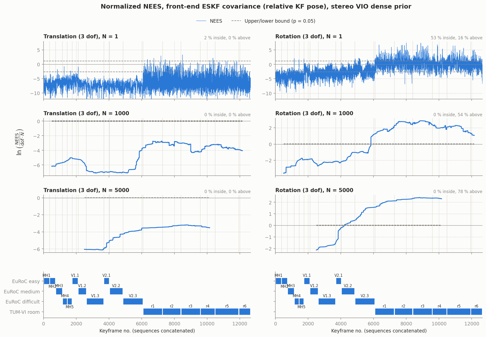
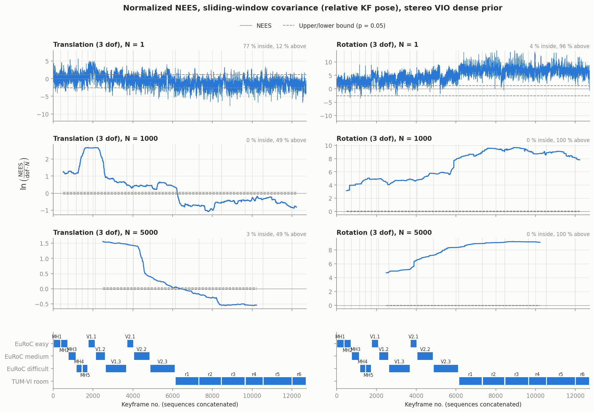

# Covariance consistency (NEES) of SaDVIO stereo VIO

Started 2026-10-13. Why: a partner team plotted the normalized NEES of their SaDVIO version (sliding windows
N = 1 / 1000 / 5000, 95 % chi-square bounds). This folder has the same test for our `dense_devel` build.

## What is tested

Configuration: `bimonovio`, dense marginalization prior (`marginalization 1`, `sparsification 0`; best window ATE in
`doc/loop_closure/results/final_matrix.md`), loop closure on, all other values from the evaluation base config. One
run per sequence, label `nees_vio_dense`, binary snapshot `nees1`. Sequences: EuRoC (all 11) and TUM-VI rooms 1-6, 12 718 KFs in total. magistrale2 is left out because its GT covers only the start and the end.

Two covariances, each tested on the pose of each new KF relative to the previous KF:

| | covariance | where |
|---|---|---|
| **A**, front end | ESKF covariance of `T_lastKF_frame` (`Frame::_dT_cov`, what `cov_mat.csv` logs the diagonal of) | `ESKFEstimator::estimateTransformBetween` |
| **B**, back end | marginal covariance of the window solve: landmarks Schur-eliminated, pseudo-inverse over the frame states (gauge freedoms get no covariance), propagated to the relative pose | `AOptimizer::computeWindowCovariance` |

B is also reported relative to the oldest window frame (`Bw`, about 1-2 s).

Error convention (both A and B): right perturbation `T = T_est [Exp(theta), rho]`, order rotation then translation.
NEES is computed separately for translation (3 dof) and rotation (3 dof). The figures plot
`ln(sum_N NEES / (dof N))` with two-sided 95 % bounds, sequences concatenated in a fixed order. With 3 dof, the
N = 1 bounds are -2.63 / +1.14, the same as in the partner figure (theirs is 3 dof too).

## Results




Per-sequence table: `results/nees_vio_dense_summary.md`. ANEES = mean NEES / dof (1 = consistent).

**A, ESKF front end: far too pessimistic in translation, not a statistical covariance.** The median σ is 64 mm per
axis against a median error of 3.3 mm. Translation ANEES is 0.00-0.05 on every sequence, so the variance is about
100-1000 times too large. Cause: the filter uses a 0.1 variance on the normalized image plane (σ ≈ 0.32, about
150 px), an identity prior and an IMU covariance ×1000. Rotation looks closer (σ 0.09°), but its errors are at the
GT noise floor (see below). The full 6-dof NEES of A explodes on the TUM-VI rooms (ANEES up to 5·10⁴), because its
rotation-translation block is nearly singular.

**B, window, translation: close to consistent, within a factor of about 3.** Overall ANEES is 2.3 and the median
NEES/dof is 0.50. At N = 1, 77 % of the KFs are inside the bounds and 12 % are above them.
- EuRoC Machine Hall: ANEES 2.7-3.8, overconfident (σ about 1.7× too small).
- EuRoC Vicon rooms: ANEES 1.4-3.7. V1_01 reaches 33, but that comes from its GT (see below).
- TUM-VI rooms: ANEES 0.36-0.68, underconfident.
The long windows (N = 1000 / 5000) look like the partner figure: above the bounds on EuRoC, below them on the rooms.

**B, window, rotation: this GT cannot test it.** σ is about 0.004° per KF step, which is the gyro white noise over
0.1-0.4 s. The GT itself disagrees with the raw gyro by 0.03-0.07° (EuRoC) and 0.17-0.22° (TUM-VI rooms) over the
same intervals (`results/nees_vio_dense_gt_rot_floor.md`, `tools/gt_rot_floor.py`; no estimator involved, and the
disagreement does not grow with the rotation step, so it is not a gyro scale error). The rotation NEES of B
(ANEES 15-13 000) is therefore set by GT noise. A fair rotation test would need GT about 50 times more accurate,
or longer horizons with the GT noise modelled.

**GT caveat, V1_01.** The relative translations of V1_01 differ from GT by an apparent fixed 5.6° rotation. Its
gyro-vs-GT floor is 0.14° (other Vicon sequences: 0.03-0.07°). MH_01/MH_02 (laser-tracker GT) show no such offset
(0.3°). The same caveat applies in spirit to the partner plot, whose GPS truth degrades in canyons and under trees.

Checks: the propagation of B to the relative pose matches a Monte Carlo (20 000 samples) within 1 %. The time
offset of GT is ~0 (the rotation error is smallest at 0 ± 3 ms).

## How to reproduce

```
SNAP=nees1 doc/nees/tools/run_nees.sh 8-15 0 2 &  SNAP=nees1 doc/nees/tools/run_nees.sh 16-23 1 2
~/miniconda3/envs/execosim/bin/python doc/nees/tools/nees_eval.py nees_vio_dense     # figures + summary
~/miniconda3/envs/execosim/bin/python doc/nees/tools/gt_rot_floor.py nees_vio_dense  # GT rotation floor
```

The covariance logging is behind `log_pose_covariance: 1` (default 0, keep it off outside evaluation runs). It only
reads the solved problem; the estimates are unchanged (flag on vs off, V1_01 and room1, 2 runs each: ATE within the
run-to-run spread). It adds about 15-40 ms per KF to the window optimization (room1 ~20 -> ~58 ms), which is harmless
offline (`multithreading: 0`) but could make a live back end fall behind. It writes `log_slam/cov_front.csv` (every
frame: ESKF `T_ref_f` and its 6×6 covariance) and `log_slam/cov_window.csv` (every VIO window solve: poses of the
newest, previous and oldest frame, their 18×18 joint covariance and the null-space size). It works in every mode
(front end) and in both VIO modes (window).
